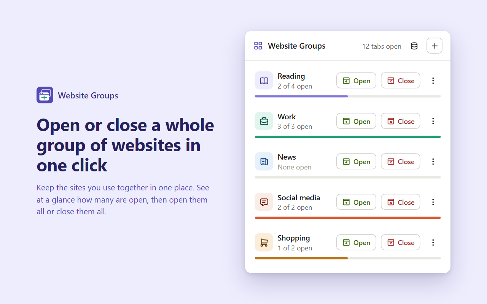

# Website Groups

A Chrome extension that opens or closes a whole group of websites in one click.

Make a group for anything you do regularly, like your morning reading, work tools or the sites that distract you. Then click the toolbar button and use:

- **Open** to open every site in the group in new tabs
- **Close** to close every open tab on those sites
- **Sort** (in the popup header) to arrange open tabs in the current window by your group order



## Features

- As many groups as you like, each with its own icon and colour
- Put groups in any order with **Move up** and **Move down** in each group's ⋮ menu
- Shows how many sites in each group are open right now
- Back up your groups to a file and import them on another computer
- Groups sync between computers through your Chrome account
- Light and dark mode
- No data collection: nothing leaves your browser except through Chrome sync

## How sites are matched

Each line in a group is either a web address or a keyword:

| Line | Open | Close |
|---|---|---|
| `facebook.com` | Opens `https://facebook.com` | Closes tabs on facebook.com and its subdomains, like m.facebook.com |
| `bbc.com/news` | Opens `https://bbc.com/news` | Closes tabs on bbc.com whose path starts with /news |
| `bible` | Opens `https://bible` (not useful) | Closes any tab whose address contains "bible" |

## Install for development

1. Download or clone this repository.
2. Open `chrome://extensions` and turn on **Developer mode**.
3. Click **Load unpacked** and choose the repository folder.

The `key` in `manifest.json` gives the unpacked copy the same extension ID as the Chrome Web Store version (`kiacknbdngediookdopfcjplciokcokm`), so it keeps the same saved groups wherever the folder is. Because the IDs match, remove the store version before loading the unpacked one.

## Build the store package

```bash
python build.py
```

This creates `dist/website-groups-<version>.zip`. It packages the pages named in `manifest.json`, their icons, and every script and stylesheet those pages load, and leaves `key` out of the manifest. If a page points at a file that doesn't exist, the build stops. Increase `version` in `manifest.json` before building an update.

## Run the tests

```bash
python tests/run.py
```

This runs `tests/test.html` in headless Chrome and prints a line per test. It needs Chrome (or Edge) installed. Set the `CHROME` environment variable if it isn't in the usual place. You can also open `tests/test.html` in Chrome to see the results.

The tests cover site matching, sorting, export and import, and storage, using a fake `chrome.storage` in `tests/fake-chrome.js`.

## Files

| File | Purpose |
|---|---|
| `manifest.json` | Extension settings and permissions |
| `popup.html`, `popup.js` | The toolbar popup: list, open, close, sort and edit groups |
| `options.html`, `options.js` | The backup page: export and import |
| `storage.js` | Saving and loading groups, shared by both pages |
| `matching.js` | Which tabs belong to a group, used by Open, Close, the counts and Sort |
| `backup.js` | The export file format and import rules |
| `ui.js` | Small page helpers shared by both pages |
| `icons.js` | Outline icons used in the interface |
| `styles.css` | Styles for both pages, including dark mode |
| `tests/` | The test page and its runner (not part of the package) |
| `store/` | Chrome Web Store listing text, privacy policy and images (not part of the package) |

## Feedback and support

Found a bug or have an idea? [Open an issue](../../issues).

## Privacy

See the [privacy policy](store/privacy-policy.html). In short: the extension doesn't collect, send or sell any data.
